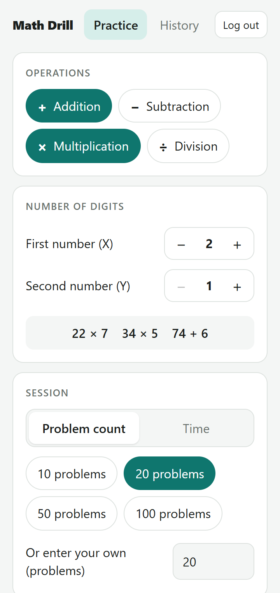
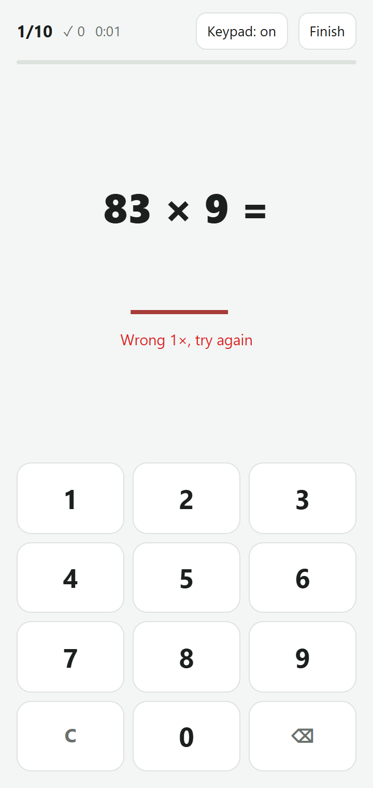
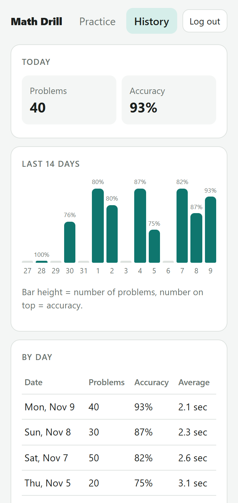

# Math Drill

[](https://github.com/ghozif/Math-Drill/actions/workflows/deploy.yml)

A fast arithmetic practice app for addition, subtraction, multiplication, and division. It runs in the browser, installs on your phone as a PWA, works offline, and tracks your daily progress. Available in English and Indonesian.

**[Try the live app](https://math-drill-b19a9.web.app)**

<table>
  <tr>
    <td></td>
    <td></td>
    <td></td>
  </tr>
</table>

## Features

- **Configurable drills:** mix any of the four operations and set X and Y from 1 to 5 digits each.
- **Clean problems:** subtraction never goes negative, and division always gives a whole number.
- **Two session modes:** practice a set number of problems or race against the clock.
- **Quick answering:** a correct answer moves on automatically, and a wrong one clears so you can retry the same problem.
- **Honest accuracy:** only first-try answers count as correct.
- **Flexible input:** use the on-screen keypad, a physical keyboard, or your phone's number keyboard.
- **Progress history:** review daily stats, a 14-day chart, and recent sessions.
- **Sign-in options:** log in with Google or with email and password.
- **Offline support:** keep practicing without a connection, and results sync once you're back online.
- **Two languages:** switch between English and Indonesian at any time.

## Tech stack

- [React 18](https://react.dev) and [Vite 5](https://vite.dev)
- [Firebase](https://firebase.google.com) Authentication, Cloud Firestore, and Hosting
- [vite-plugin-pwa](https://vite-pwa-org.netlify.app) for installation and offline support
- GitHub Actions for tests, preview deployments, and production deployment

## Getting started

### Prerequisites

- [Node.js](https://nodejs.org) 22 (the version used in CI)
- A [Firebase](https://console.firebase.google.com) project (the free Spark plan is enough)
- [Firebase CLI](https://firebase.google.com/docs/cli), for deploying: `npm install -g firebase-tools`

### 1. Set up Firebase

In the [Firebase console](https://console.firebase.google.com):

1. Create a project.
2. Go to **Authentication > Sign-in method** and enable **Google** and **Email/Password**.
3. Go to **Firestore Database** and create a database in **production mode**, in a region close to your users.
4. Go to **Project settings > Your apps** and register a web app. Keep its config values for the next step.

### 2. Run the app locally

```bash
git clone https://github.com/ghozif/Math-Drill.git
cd Math-Drill
npm install
cp .env.example .env    # then fill in your Firebase config values
npm run dev
```

The app runs at <http://localhost:5173>.

## Scripts

| Command | Description |
| --- | --- |
| `npm run dev` | Start the development server |
| `npm test` | Test the problem generator and check that translations are complete |
| `npm run build` | Build for production into `dist/` |
| `npm run preview` | Serve the production build locally |

## Deployment

### Manual

```bash
firebase login
firebase use --add      # select your Firebase project
npm run build
firebase deploy         # deploys Hosting and the Firestore security rules
```

To deploy only the website, run `firebase deploy --only hosting`.

### Automatic

| Workflow | Trigger | Result |
| --- | --- | --- |
| [`deploy.yml`](.github/workflows/deploy.yml) | Push to `main` | Tests, builds, and deploys to production |
| [`firebase-hosting-pull-request.yml`](.github/workflows/firebase-hosting-pull-request.yml) | Pull request from this repository | Tests, builds, and publishes a temporary preview |

If you fork this project, add the following under **Settings > Secrets and variables > Actions** in your repository:

- **Variables:** the six `VITE_FIREBASE_*` values from `.env.example`
- **Secret:** `FIREBASE_SERVICE_ACCOUNT_MATH_DRILL_B19A9`, containing a Firebase service account key. `firebase init hosting:github` can create one for you, but it names the secret after your project ID, so update the workflow files to match. Also replace the hardcoded `projectId` in `firebase-hosting-pull-request.yml`.

These workflows deploy Hosting only. If you change `firestore.rules`, deploy it with `firebase deploy --only firestore:rules`.

## Project structure

```text
src/
├── App.jsx            # Auth state and screen navigation
├── firebase.js        # Firebase initialization
├── components/        # Screens and shared UI, including the i18n provider
└── lib/
    ├── generator.js   # Problem generation rules
    ├── i18n.js        # Translations and locale-aware formatting
    ├── sessions.js    # Firestore reads and writes
    ├── settings.js    # Practice settings stored in localStorage
    └── stats.js       # Session summaries and daily grouping
tests/                 # Generator and translation tests
firestore.rules        # Firestore security rules
```

## Adding a language

1. Add the language to `LANGUAGES` in [`src/lib/i18n.js`](src/lib/i18n.js), with its display name and locale.
2. Add a matching block to `MESSAGES`, with every key translated.
3. Run `npm test`. It fails if a key or placeholder is missing.

The language switch picks up the new language automatically.

## Data and security

- Each session stores only a summary, not every problem, to stay within Firestore's free quota.
- Practice settings and the language choice stay in the browser, on each device.
- [Firestore rules](firestore.rules) only let signed-in users read, add, and delete their own sessions.
- The `VITE_FIREBASE_*` values are included in the public web build, as is normal for Firebase web apps. Access to data is enforced by Authentication and the Firestore rules, so never put a service account key in `.env` or any `VITE_` variable.
